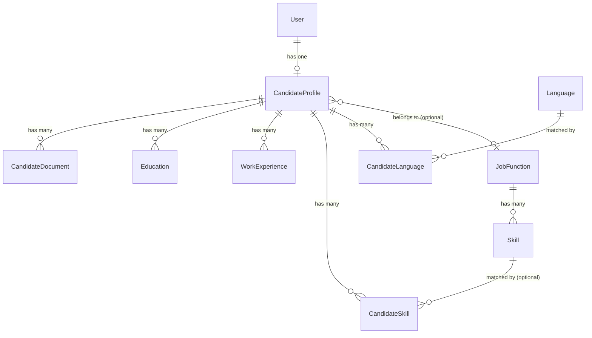
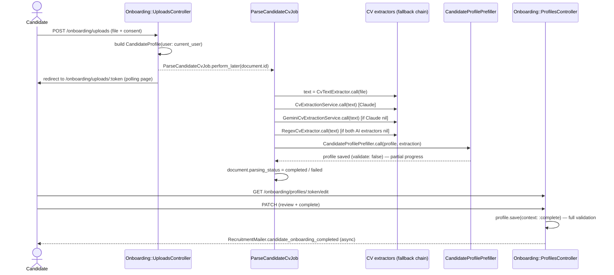
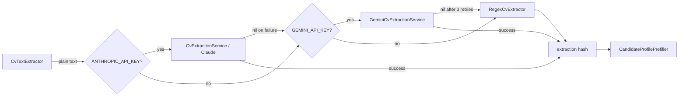

# Architecture

How the pieces of SmileRecruit fit together — domain model, request flows, the CV-extraction pipeline, and auth. Written for someone about to change this code; see the [README](../README.md) for setup.

## Contents

- [Domain model](#domain-model)
- [Models at a glance](#models-at-a-glance)
- [Onboarding flow (candidate)](#onboarding-flow-candidate)
- [CV extraction fallback chain](#cv-extraction-fallback-chain)
- [Services at a glance](#services-at-a-glance)
- [Authentication & authorization](#authentication--authorization)
- [Forms: BootstrapFormBuilder](#forms-bootstrapformbuilder)
- [Background jobs](#background-jobs)
- [Directory map](#directory-map)
- [Known sharp edges](#known-sharp-edges)

## Domain model



`AdminUser` isn't in this diagram — it has no relationship to any of the above at all. It's a fully separate Devise scope used only to gate `/admin`.

## Models at a glance

| Model | Belongs to / has | Notable fields | Purpose |
|---|---|---|---|
| `User` | `has_one :candidate_profile, dependent: :destroy` | Devise: email, password | Candidate account. Self-registers. |
| `AdminUser` | *(none)* | Devise: email, password | Recruiter account. Seeded only, no self-registration. |
| `CandidateProfile` | `belongs_to :user, optional: true`; `belongs_to :job_function, optional: true`; has many `candidate_documents`, `educations`, `work_experiences`, `candidate_skills`, `candidate_languages` | `access_token` (URL identifier); `onboarding_step` (`cv_upload → profile_review → completed`); `employment_types`/`available_working_days`/`preferred_regions`/`transport_types` (JSON arrays, Ruby-level default `[]`) | The actual onboarding record being filled in. |
| `CandidateDocument` | `belongs_to :candidate_profile`; `has_one_attached :file` | `parsing_status` (`pending/processing/completed/failed`); `parsing_method` (`basic`/`ai`) | One row per uploaded CV file. |
| `Education` / `WorkExperience` | `belongs_to :candidate_profile` | `source` (`manual`/`extracted`) | Nested repeater records; `extracted` entries get a "Please check" badge. |
| `CandidateSkill` | `belongs_to :candidate_profile`; `belongs_to :skill, optional: true` | `suggested_name` (free text if no `Skill` match) | Links a profile to a platform `Skill`, or a recruiter-reviewable suggestion. |
| `CandidateLanguage` | `belongs_to :candidate_profile`; `belongs_to :language` | `level` (free text, e.g. "native", "B2") | Join record between a profile and a `Language`. |
| `JobFunction` | `has_many :skills`; `has_many :candidate_profiles` | `clinical_group`; `clinical?` | Reference data — drives which conditional fields show (BIG registration, revenue). |
| `Skill` / `Language` | scoped to `JobFunction` / standalone | — | Reference data, seeded via `db/seeds.rb`. |

**Why `AdminUser` and not `Admin`:** `Admin` is already the controller namespace (`Admin::BaseController`, `Admin::CandidateProfilesController`) — a model class and a namespacing module can't share one Ruby constant, so the recruiter model had to be named something else.

## Onboarding flow (candidate)



### Things that aren't obvious from reading one file at a time

| Behavior | Why it works this way |
|---|---|
| The whole flow requires being signed in | `Onboarding::BaseController` (parent of `UploadsController` and `ProfilesController`) has `before_action :authenticate_user!`. There's no anonymous/token-only path — the `access_token` in the URL is a *second* factor on top of authentication, not a replacement for it. |
| A signed-in user with an existing profile can't start a second one | `UploadsController#new`/`#create` call `redirect_to_existing_profile` first: if `current_user.candidate_profile` already exists, it redirects to that profile's current step instead of building a new `CandidateProfile`. (`candidate_profiles.user_id` has no unique DB index — this guard is the only thing actually preventing duplicates.) |
| A half-filled AI-prefilled profile is never "invalid" | Most presence validations on `CandidateProfile` live inside `with_options on: :complete do ... end`. The prefill save uses `validate: false`; only the final submit runs with `context: :complete`. |
| A CV's languages can silently resolve to the *wrong* `Language` row | `CandidateProfilePrefiller#find_or_create_language` looks up by name first, then guesses an ISO-639-1-ish code from the first two letters if creating a new one — which can collide with an *existing* `Language`'s code (a Dutch CV's "Engels" guesses `"en"`, already taken by the seeded "English"). It falls back to the existing code match rather than raising. |
| A parsing failure never leaves a document stuck forever | `ParseCandidateCvJob` wraps the whole prefill step in `rescue StandardError` and marks the document `failed` instead of propagating. Before this existed, an unrescued error here left the document on `processing` forever — an infinite "Analyzing your CV…" spinner with no way out. |

## CV extraction fallback chain



All three extractors share the same output contract: a symbolized hash matching `CvExtractionService::RESPONSE_SCHEMA`, or `nil` on failure/not-configured. `ParseCandidateCvJob` doesn't need to know which one ran — it just uses the first non-nil result.

| Extractor | Requires | Can fill | Notes |
|---|---|---|---|
| `CvExtractionService` (Claude) | `ANTHROPIC_API_KEY` | Everything: personal details, summary, education, work experience, skills, languages | Full structured-output extraction. |
| `GeminiCvExtractionService` | `GEMINI_API_KEY` | Same as Claude | Talks to the REST API directly via `Net::HTTP` — no official Google Ruby SDK. Retries `429`/`5xx`/network errors up to `MAX_ATTEMPTS` times with backoff before giving up (the free tier returns `503 UNAVAILABLE` under load fairly often). Uses `gemini-flash-latest` (an alias, not a pinned version — `gemini-2.5-flash` 404s for newer API keys/projects even while still listed in `GET /models`). |
| `RegexCvExtractor` | Nothing | Only `first_name`/`last_name`/`email`/`phone_number` (occasionally `city`) | Hard ceiling, not a bug — education/work experience/skills/languages need real language understanding, which regex can't do. Runs when neither AI key is configured, or both AI calls fail. |

**Gemini's schema is not JSON Schema.** Google uses its own proto-based Schema dialect: `type` is a single uppercase enum (`STRING`/`OBJECT`/`ARRAY`/…), nullability is a sibling `nullable: true` key instead of `type: ["string", "null"]`, and `additionalProperties` isn't a recognized field at all. `GeminiCvExtractionService.to_gemini_schema` converts `CvExtractionService::RESPONSE_SCHEMA` once at load time, so there's one schema to maintain instead of two.

Both AI extractors share `CvExtractionService::SYSTEM_PROMPT`, which explicitly forbids inventing data and forbids translating extracted text — a Dutch CV's language names, job titles, etc. come back in Dutch (see the language-matching row in the table above for why that matters downstream).

## Services at a glance

| Service | Input → Output | Called from |
|---|---|---|
| `CvTextExtractor` | Active Storage attachment → plain text (PDF/DOCX/legacy `.doc`) | `ParseCandidateCvJob` |
| `CvExtractionService` | plain text → structured hash or `nil` | `ParseCandidateCvJob` |
| `GeminiCvExtractionService` | plain text → structured hash or `nil` | `ParseCandidateCvJob` |
| `RegexCvExtractor` | plain text → structured hash or `nil` | `ParseCandidateCvJob` |
| `CandidateProfilePrefiller` | structured hash + `CandidateProfile` → profile + nested records saved | `ParseCandidateCvJob` |

## Authentication & authorization

Two independent Devise scopes, deliberately asymmetric:

| | `User` (candidate) | `AdminUser` (recruiter) |
|---|---|---|
| Devise modules | `database_authenticatable`, `registerable`, `recoverable`, `rememberable`, `validatable` | `database_authenticatable`, `recoverable`, `rememberable`, `validatable` — **no** `registerable` |
| How accounts are created | Self-service sign-up at `/users/sign_up` | `db/seeds.rb` / Rails console only |
| Guard | `Onboarding::BaseController#authenticate_user!` | `Admin::BaseController#authenticate_admin_user!` |
| Redirect after sign-in | `root_path` (Devise default) | `admin_root_path` (`ApplicationController#after_sign_in_path_for` special-cases this one scope) |

`Onboarding::BaseController#set_profile` is the authorization layer, not just a lookup:

```ruby
def set_profile
  @profile = current_user.candidate_profile
  raise ActiveRecord::RecordNotFound if @profile.nil? || @profile.access_token != params[:access_token]
end
```

Both the session **and** the token in the URL have to match the same user's own profile — a signed-in user can't view or edit another candidate's profile even with a guessed or shared `access_token` link.

The layout (`app/views/layouts/application.html.erb`) picks which auth UI to show in the navbar by checking `request.path.start_with?("/admin")` (this also covers `/admin_users/*`, Devise's own routes for that scope) — admins never see the candidate "Log in"/"Sign up" links, since they can't self-register anyway.

## Forms: `BootstrapFormBuilder`

`app/form_builders/bootstrap_form_builder.rb` is used everywhere (`form_with ..., builder: BootstrapFormBuilder`, including the Devise views) so every field gets consistent styling without each view hand-repeating classes.

| Behavior | Detail |
|---|---|
| Default classes | `form-control` on text-style fields, `form-select` on `select` — anything passed via `class:` at the call site is appended, not replaced. |
| Inline validation errors | Adds Bootstrap's `is-invalid` + an adjacent `invalid-feedback` div when the field's attribute has an error. Checks not just the exact attribute name but also its `_id`-stripped (association) and `_text`-stripped (writer-accessor) forms — Rails errors don't always key on the literal form-field name (e.g. `job_function_id`'s error lives on `:job_function`). |
| `field_error_proc` disabled | `config/initializers/field_error_proc.rb` turns off Rails' default `<div class="field_with_errors">` wrapper — it sits between the input and the builder's own `invalid-feedback` div and breaks the adjacent-sibling CSS Bootstrap needs to show it. |
| Checkbox groups | Groups built with raw `check_box_tag` (Languages, Employment type, Available working days — not single `f.check_box` calls) bypass the form builder entirely. They get error styling from a separate pair of helpers instead: `group_validation_class` / `group_validation_feedback` in `ApplicationHelper`. |

## Background jobs

| Job | Trigger | Dev queue adapter | Caveat |
|---|---|---|---|
| `ParseCandidateCvJob` | CV upload | `:async` (in-process thread pool) | Not persisted — a job enqueued right before a server restart is silently lost. Reads as a permanently-stuck "Analyzing your CV…" spinner if it happens. Production uses `solid_queue`. |
| `RecruitmentMailer#candidate_onboarding_completed` | Final profile submit | same | Enqueued, not sent inline. |

## Directory map

```
app/
  controllers/
    admin/                          # recruiter-facing, gated by Admin::BaseController
    onboarding/                     # candidate-facing wizard, gated by Onboarding::BaseController
  form_builders/                    # BootstrapFormBuilder
  jobs/                             # ParseCandidateCvJob
  javascript/controllers/
    dropzone_controller.js          # drag-and-drop file input (upload form)
    conditional_fields_controller.js  # show/hide salary vs percentage vs BIG fields
    nested_fields_controller.js     # add/remove Education & Work Experience rows
  mailers/
  models/
  services/
    cv_text_extractor.rb            # file -> plain text (PDF/DOCX/legacy DOC)
    cv_extraction_service.rb        # text -> structured hash, via Claude
    gemini_cv_extraction_service.rb # same contract, via Gemini
    regex_cv_extractor.rb           # same contract, no AI — name/email/phone only
    candidate_profile_prefiller.rb  # structured hash -> CandidateProfile + nested records
docs/
  ARCHITECTURE.md                   # this file
db/
  seeds.rb                          # job functions, skills, languages, one AdminUser
```

## Known sharp edges

| Issue | Why | What to do |
|---|---|---|
| MySQL 5.7 JSON columns can't have DB-level defaults | Support for `DEFAULT` on `JSON` columns was added in MySQL 8.0.13; this app targets 5.7 | Set the default via `attribute :name, default: -> { ... }` on the model, not `default:` in the migration — see `CandidateProfile`. |
| `:async` job adapter loses work on restart | In-process thread pool, no persistence (dev only) | Don't restart the dev server while a CV parse is in flight. Production uses `solid_queue`. |
| Gemini free tier returns transient `503`s under load | Shared capacity, no SLA | Already retried automatically by `GeminiCvExtractionService`. If it still fails, the candidate gets a working (regex-only) profile — never a hang or crash. |
| Neither AI key is required | By design | The app is fully functional with zero configuration, just at reduced (name/email/phone-only) extraction quality. |
